<!-- status: zh -->
# 罗梅迷宫

> 原文：[ローメイの迷宮](https://w.atwiki.jp/ryonarpgb/pages/195.html) ｜ 译自 RyonaRPG 勝手にwiki

## 罗梅迷宫

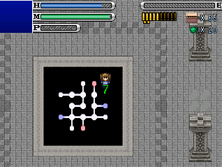

### 概要

- 出现条件：与施瓦茨梅德亨酒馆里的男性对话（BOSS 击破数 10 体以上）

大概是每次进入迷宫都会随机生成的迷宫。
各个区域本身也是迷宫，非常容易迷路，但宝箱很多、不可见的陷阱很少。
宝箱里多为灵药等道具类[道具](./161.md)。
另外还能捡到珍贵的梅尔利昂卡克之箭和阿罗马尔瓦尔之箭。

陷阱的伤害值大概按最大 HP 的比例计算，因此无法靠防御等手段应对。
由于容易受到陷阱伤害，药水经常不够用。
带上ケアル等吧。
可以用迷宫内大量获得的灵药回复 HP（也许）。

### 宝箱

迷宫区域的宝箱有三种。
可通过外观判断里面装的是什么。
该规则不适用于特殊区域。（会开出金块等[道具](./161.md)）

#### 宝箱1

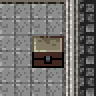

装有灵药类的[道具](./161.md)。

#### 宝箱2

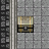

装有道具类的[道具](./161.md)（玛皮斯之光、星之护符等）。

#### 宝箱3

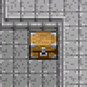

装有魔法硬币。

#### 地图的看法

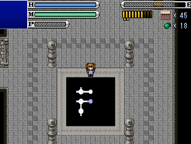

途中各处都放置着地图。
看懂地图的看法后攻略会轻松许多。
顺带一提，最深处的地图除外。

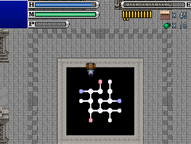

最深处放置着全图。
北侧的红色房间是最深处（终点）。
北侧的白色房间是传送房间（可返回起点）。
南侧的红色房间是起点。
左右两侧的蓝色房间是开关房间。
左右两侧的白色房间是传送房间（可相互移动）。
南侧的白色房间是箭之房间。

### 主要攻略流程

请在理解地图看法的基础上阅读。
首先以最北端的最深处为目标吧。
只要去过一次最深处，就能与 BOSS 战斗。

如果想要更好的报酬，就先截图最深处的地图。
去左右两侧的开关房间后再前往最深处吧。

想要審判者装備的话，就收集 10 枚魔法硬币吧。
一次收集 10 枚是不可能的，所以先带回一次、攻略 2～3 轮比较好。

### 迷宫区域

有敌人、陷阱、宝箱的区域。
为方便起见，用 ☆ 表示危险度。

#### 森林区域

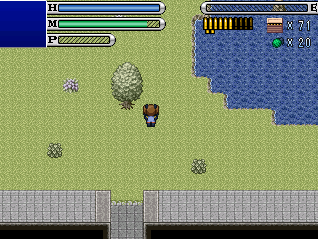

☆
安全。
既没有敌人也没有陷阱的区域。但有宝箱。
遇到就算走运。
不过，不能在该区域停留 60 秒以上。
会出现带着黑色特效、名为梦貘人的敌人，
以 4 倍速接近，并以攻击力 1800 发动攻击。

#### 毒沼区域

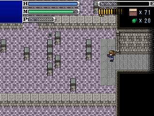

☆☆☆☆☆
相当危险。
进入毒沼后，约每秒受到最大 HP 10% 的伤害。
而且不穿泳装等时移动速度会下降。
该毒沼的伤害无法通过装备等应对。

这里的幼女系敌方角色名为「フレッシュゴーレム」，
攻击力高达 340，注意不要撞上。

#### 电气陷阱区域

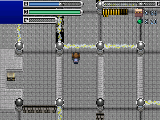

☆☆☆☆
布置着电气陷阱的区域。
大概会连续受到 HP 5% 的伤害。
无法用雷耐性减轻。

因为没有敌人，可以通过休息回复。

#### 棘刺陷阱与地雷的迷宫

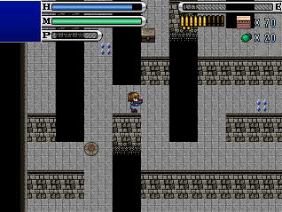

☆☆
会受到棘刺陷阱约 HP 10%、地雷约 HP 20% 的伤害。
此外还放置着会随机产生效果的陷阱。
棘刺陷阱从一开始就可见，其他陷阱则不可见。

不过陷阱伤害低、敌人动作慢，算是比较安全的区域。

#### 冰床区域

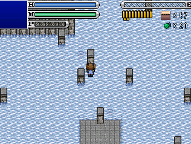

☆
在冰面上滑行前进的区域。
踩上冰面后会一直直进，直到撞上墙壁。
因为没有敌人，比较安全。
中央放置着大量宝箱。

#### 轨道刃区域

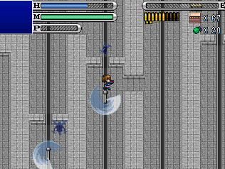

☆☆☆☆
刀刃从画面外高速飞来的迷宫。
碰到刀刃会受到约 HP 40% 的伤害。
躲进墙上的凹陷处回避吧。
杂兵为非实体，只有圣属性或力属性有效。

#### 水路区域

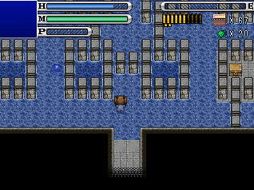

☆☆
不穿泳装时移动速度会下降。
有名为アクア史莱姆的敌人，但不会发动色情系攻击。
比较安全的区域。
冒水泡的地方放置着捕兽夹。

#### 长枪区域

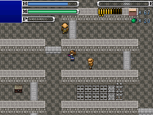

☆☆☆
布置着长枪刺出陷阱的区域。
被命中会受到约 HP 33% 的伤害。
有沿横向依次刺出的模式，以及不规则刺出的模式。
依次刺出的模式，只要「跟在已经刺出的枪后面前进」就能回避。
容易卡顿。

有名为メイズゴブリン的敌人，攻击力高达 370，动作也比较快。
需要小心。

#### 切割刀刃区域

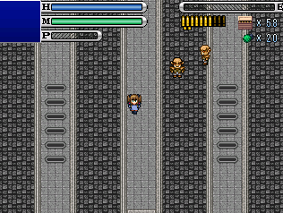

☆☆☆
通路中会刺出类似切割刀刃之物的区域。
被命中会受到约 HP 33% 的伤害。
该区域也有メイズゴブリン。

#### 箭陷阱区域

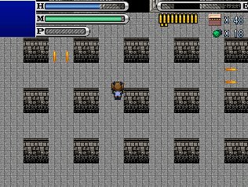

☆☆
有箭飞来的区域。
箭很快但伤害较低。约为 HP 的 1/4～1/5？
地图呈水田的「田」字形，不容易迷路。

#### 熔岩迷宫

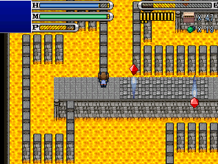

☆☆
碰到水晶冒出的火焰会受到 HP 1/9 的伤害。
杂兵也不太强，但无属性较难生效，需要注意。

#### 圆盘区域

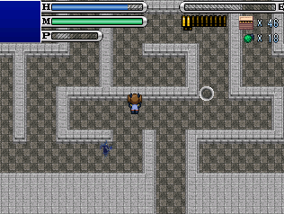

☆☆☆
沿墙壁高速移动的圆盘袭来的区域。
沿右侧墙壁高速移动，但伤害较低。约为最大 HP 的 1/9？
道路宽度只有 2 格，而且难以分辨圆盘是从前面还是后面来。
有意回避很难，最好尽快脱离。

#### 中BOSS 房间

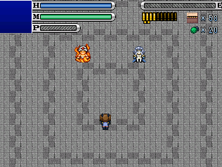

BOSS アフリット和シベル会袭来。
两者分别发动炎、冰属性攻击。
两者的种族都是「神」，因此会将所有伤害减轻 50%。
而且动作很快，近战会很吃力。

### 特殊区域

没有敌人的区域。

#### 传送房间

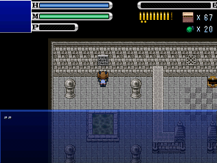

石板上没有写信息，详细不明。
踩下绿色液体的正中央，就会传送到另一个相似的房间。

#### 开关房间

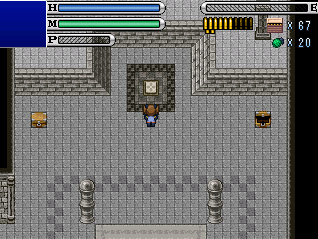

放置着开关和宝箱的房间。在地图上表示为蓝色的死路。
按下两处开关房间的开关后，就能进入最深处的宝箱房间。

#### 箭之房间

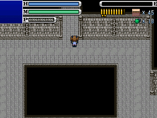

南侧的死路房间一定会通往这里。
里面有 2 个宝箱，必定能获得梅尔利昂卡克之箭、阿罗马尔瓦尔之箭。

#### 最深处

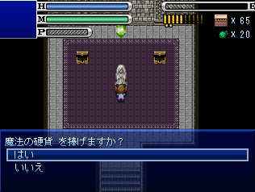

放置着女神像。在地图上表示为红色的死路。
可以献上在迷宫内捡到的魔法硬币。
根据献上的数量获得道具。
注意离开迷宫后献上的数量会重置。
5 枚可获得审判者之锡杖。
10 枚可额外获得审判者之腕轮。
两者的效果均未实装。

另外，若在途中两处开关房间打开开关，就能进入宝箱房间。
可获得灵魂壶等。

可从深处的水晶返回入口大厅。

#### 入口大厅

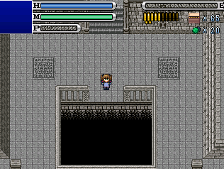

从最深处返回后，中央的栅栏会打开，可以跳进去。
跳进去就能与 BOSS 战斗。

### BOSS 战

#### 地下

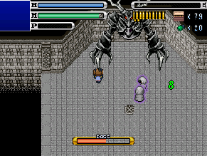

可以与 BOSS 邪龙石像战斗。
BOSS 的攻击只要在移动就大多不会命中，比较容易躲开。
随从的 HP 有 1400，与其打倒不如逃跑。

打倒后的宝箱中可获得幸运维纳斯、艾尔斯库拉里奥。
第二次以后会变为能力强化道具。

### 事件
